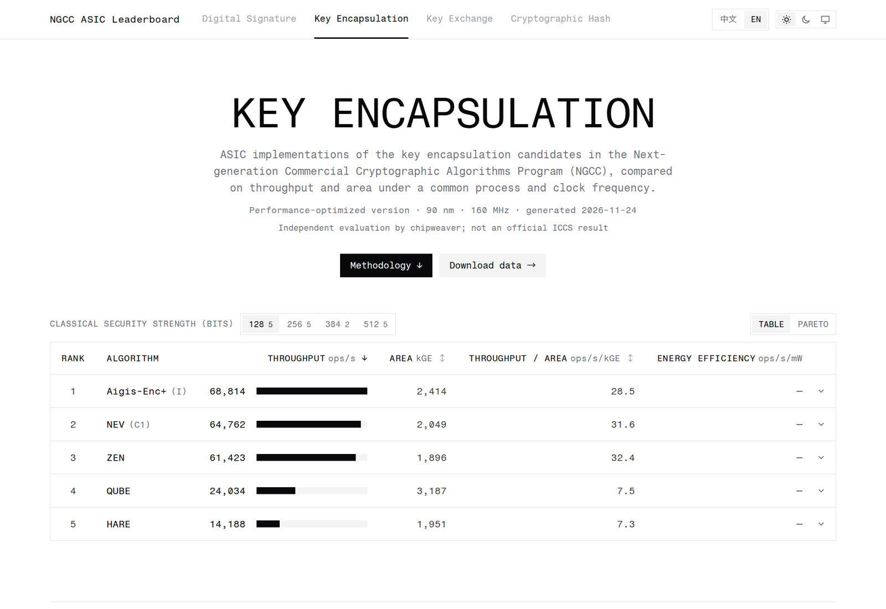

<h1 align="center">NGCC ASIC Leaderboard</h1>

<h3 align="center">ASIC implementations of NGCC candidate algorithms, compared and published</h3>

<p align="center">English | <a href="README.zh.md">中文</a></p>

---

The NGCC ASIC Leaderboard compares **ASIC implementations of the candidate
algorithms in the Next-generation Commercial Cryptographic Algorithms Program
(NGCC) on throughput and area under a common process and clock frequency**, and
publishes the RTL of every implementation it ranks.

**This is an independent evaluation by chipweaver, not an official ICCS result.**
The leaderboard is published at <https://chipweaver.github.io/ngcc-asic-leaderboard/>.

<p align="center">
  <a href="https://chipweaver.github.io/ngcc-asic-leaderboard/">
    <picture>
      <source media="(prefers-color-scheme: dark)" srcset="assets/leaderboard-en-dark.png">
      
    </picture>
  </a>
  <br>
  <sub>Key encapsulation page · <a href="https://chipweaver.github.io/ngcc-asic-leaderboard/">Open the leaderboard</a></sub>
</p>

## Contents

| Category | Directory | Implementations |
|---|---|---|
| Digital Signature | — | No results yet |
| Key Encapsulation | [`kem/`](kem/) | Aigis-Enc+, HARE, NEV, QUBE, ZEN (performance-optimized) |
| Key Exchange | — | No results yet |
| Cryptographic Hash | — | No results yet |

## Evaluation rules

- Metric definitions follow the ICCS ASIC self-evaluation guide for
  next-generation commercial cryptographic algorithms (新一代商用密码算法 ASIC
  实现自评估指引, June 2026).
- Performance-optimized versions, 90 nm process, 160 MHz clock. Every
  implementation passes static timing analysis at that frequency.
- **Throughput** is operations per second, from mean clock cycles. What counts as
  one operation is defined per category in the methodology section of its page.
- **Area** is post-synthesis logic area plus SRAM area, normalized to NAND2 gate
  equivalents (kGE). **Throughput / area** = throughput ÷ area.
- Results are grouped by the NGCC classical security strength levels (128, 256
  and 512 bits, plus the optional 384 bits) and compared only within a level.
- **Differences from the guide:** the clock is fixed at 160 MHz with no frequency
  sweep, and SRAM area is a CACTI 90 nm estimate rather than a foundry memory
  macro, so the numbers are comparable only within this leaderboard.

## Repository layout

```
<category>/                 e.g. kem/
  category.json             core operations, what one operation is, size fields, page texts
  <implementation>/
    result.json             latest result of the implementation (history is in git)
    rtl/
      rtl-files.json        RTL file list in compile order, and include directories
      src/                  SystemVerilog sources
site/                       page template and fonts
assets/                     screenshots used in this README
build.py                    validates the data and generates the site
```

## Using the RTL

The sources are synthesizable SystemVerilog, compiled in the order of
`rtl/rtl-files.json`. SRAM modules are behavioural models in simulation and
black-box memory macros when `SYNTHESIS` is defined; **synthesis needs memory
macros for the target process.**

## Building the site

```bash
python3 build.py          # writes dist/; open dist/kem/index.html
```

Only the Python 3 standard library is needed. The build fails and lists the
problems if the data are inconsistent.

## License

Code (RTL, `build.py`, site template) is under the [MIT License](LICENSE). Data
and text (`*/category.json`, `*/*/result.json`) are under [CC BY 4.0](LICENSE-DATA).
Fonts in `site/fonts/` are under the SIL Open Font License 1.1. The algorithm
designs belong to their submitters; this repository contains chipweaver's
hardware implementations only.

[MIT License](LICENSE) · [CC BY 4.0 (data)](LICENSE-DATA) · [Issues](https://github.com/chipweaver/ngcc-asic-leaderboard/issues)
