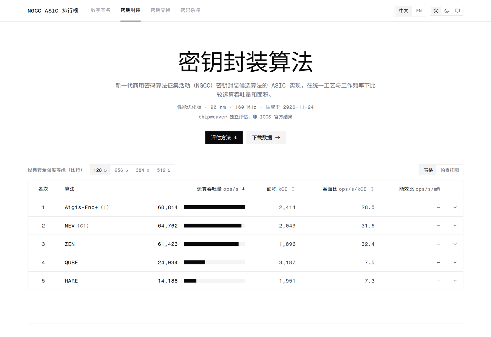

<h1 align="center">NGCC ASIC 排行榜</h1>

<h3 align="center">NGCC 候选算法 ASIC 实现的比较与公开</h3>

<p align="center"><a href="README.md">English</a> | 中文</p>

---

NGCC ASIC 排行榜**在统一工艺与约束下，比较新一代商用密码算法征集活动（NGCC）候选算法 ASIC 实现的运算吞吐量和面积**，并公开所列每个实现的 RTL。

**本榜由 chipweaver 独立评估，非 ICCS 官方结果。** 网页地址：<https://chipweaver.github.io/ngcc-asic-leaderboard/>。

<p align="center">
  <a href="https://chipweaver.github.io/ngcc-asic-leaderboard/">
    <picture>
      <source media="(prefers-color-scheme: dark)" srcset="assets/leaderboard-zh-dark.png">
      
    </picture>
  </a>
  <br>
  <sub>密钥封装页面 · <a href="https://chipweaver.github.io/ngcc-asic-leaderboard/">打开排行榜</a></sub>
</p>

## 收录内容

| 类别 | 目录 | 实现 |
|---|---|---|
| 数字签名 | — | 暂无结果 |
| 密钥封装 | [`kem/`](kem/) | Aigis-Enc+、HARE、NEV、PolarLAC、QUBE、ZEN（性能优化版） |
| 密钥交换 | — | 暂无结果 |
| 密码杂凑 | — | 暂无结果 |

## 评估规则

- 指标定义参照商用密码标准研究院《新一代商用密码算法 ASIC 实现自评估指引》（2026 年 6 月）。
- 实现版本为性能优化版，工艺为 90 nm。各实现采用相同的综合约束模板，在各自的工作频率下通过静态时序分析。
- **运算吞吐量**为单位时间内完成的运算次数（ops/s），等于工作频率 ÷ 一次运算的平均时钟周期数。各类别如何计为"一次运算"，见对应网页的"评估方法"。
- **面积**为综合后逻辑面积与 SRAM 面积之和，以 NAND2 等效门数表示，即面积除以工艺库二输入与非门（NAND2）的面积，单位 kGE（千门）。**吞面比** = 运算吞吐量 ÷ 面积。**能效比** = 运算吞吐量 ÷ 总功耗。
- 按 NGCC 规定的经典安全强度等级（128、256、512 比特，以及可选的 384 比特）分组，仅在同一等级内比较。
- **与指引的差异：** 工作频率取综合目标频率（最差建立时间裕量接近 0），未做频率扫描；SRAM 面积由 CACTI 90 nm 估算。

## 目录结构

```
<类别>/                     例如 kem/
  category.json             该类别的核心操作、一次运算的组成、尺寸字段和网页文字
  <实现>/
    result.json             该实现的最新结果（历史版本见 git 记录）
    rtl/
      rtl-files.json        RTL 文件清单（编译顺序）和 include 目录
      src/                  SystemVerilog 源码
site/                       网页模板与字体
assets/                     本说明中的截图
build.py                    校验数据并生成网页
```

## RTL 使用说明

源码为可综合的 SystemVerilog，按 `rtl/rtl-files.json` 中的顺序编译。SRAM 模块在仿真时为行为模型，定义 `SYNTHESIS` 后作为黑盒存储宏，**综合时需要提供目标工艺的存储宏**。

## 本地生成网页

```bash
python3 build.py          # 输出到 dist/，打开 dist/kem/index.html
```

只需 Python 3 标准库。数据不一致时构建会失败，并列出问题。

## 许可

代码（RTL、`build.py`、网页模板）采用 [MIT 许可证](LICENSE)；数据与文字（`*/category.json`、`*/*/result.json`）采用 [CC BY 4.0](LICENSE-DATA)；`site/fonts/` 中的字体采用 SIL Open Font License 1.1。各算法的设计归其提交者所有，本仓库只包含 chipweaver 的硬件实现。

[MIT 许可证](LICENSE) · [CC BY 4.0（数据）](LICENSE-DATA) · [问题反馈](https://github.com/chipweaver/ngcc-asic-leaderboard/issues)
